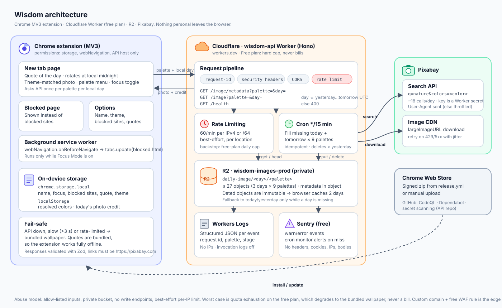

# Wisdom architecture

Two repos. [`ravnhq/wisdom`](https://github.com/ravnhq/wisdom) is the Chrome extension. [`raulpenate/wisdom-api`](https://github.com/raulpenate/wisdom-api) is the Cloudflare Worker that serves the daily photo.

## What runs where

| Piece | Runs on | Job |
|---|---|---|
| New tab | Extension page | Quote of the day, theme-matched photo, focus toggle, palette menu |
| Blocked page | Extension page | Replaces a blocked site while Focus Mode is on |
| Background worker | Extension service worker | `webNavigation.onBeforeNavigate` → redirect blocked sites |
| `wisdom-api` | Cloudflare Worker (Hono), free plan | Serves `/image` and `/image/metadata`, refreshes photos on a cron |
| `wisdom-images-prod` | R2 (private bucket) | `daily-image/<day>/<palette>`, at most 27 objects |
| Pixabay | Third party | Photo search by color, image CDN |
| Workers Logs, Sentry | Cloudflare, Sentry free | JSON logs, error events, cron monitor |

## Daily cycle

- **Quote.** Rotates at the user's local midnight. It's chosen on device from the bundled list, so it needs no network. Tabs that stay open roll over too.
- **Photo.** There's one per palette per UTC day. The API keeps yesterday, today, and tomorrow, so every timezone from UTC-12 to UTC+14 gets a new photo at its own midnight.
- **Cron `*/15 * * * *`.** Fills any missing today or tomorrow image, never repeats yesterday's photo, and deletes older days. It's idempotent, so a failed run heals on the next one. Steady state is about 9 Pixabay searches a day.
- **Client calls.** At most one metadata call and one image download per palette per local day. Dated responses are `immutable`, and the extension caches the credit, so repeat new tabs make no API calls.

## API

| Route | Notes |
|---|---|
| `GET /image/metadata?palette=<id>&day=<YYYY-MM-DD>` | Credit and links. Cached 2 days, or 5 minutes on a fallback |
| `GET /image?palette=<id>&day=<YYYY-MM-DD>` | JPEG streamed from R2, ETag and 304 |
| `GET /health` | Liveness |

`palette` is one of `teal blue purple pink red orange yellow green graphite`. `day` must be yesterday, today, or tomorrow in UTC, and anything else returns 400. Without `day`, the API serves today, which keeps older extension builds working.

## Security and cost

- **No user data.** The extension sends only a palette name and a date. Name, blocked sites, and history stay on device.
- **Least privilege.** Manifest permissions are `storage`, `webNavigation`, and host access to the API origin. There's no `tabs` and no `<all_urls>`.
- **Read-only surface.** No write endpoints, no auth to steal, and the bucket isn't public. The Pixabay key is a Worker secret and is never logged.
- **Abuse.** The limit is 60 requests a minute per IPv4 address, or per IPv6 /64 so rotating addresses doesn't bypass it. Inputs go through allow-lists, errors are generic, and security headers are on.
- **Cost ceiling.** The Workers free plan caps at 100k requests a day and never bills. A flood degrades to the bundled wallpaper and doesn't take the extension down. R2 and the cron stay inside the free tiers.
- **Supply chain.** CodeQL, Dependabot, and secret scanning with push protection. No remote code in the extension.

## Observability

- **Logs.** One JSON line per event, with request ID, palette, day, and failing stage (`search`, `download`, or `store`). There are no IPs, and Cloudflare invocation logs are off.
- **Sentry.** Warnings and errors from `log()`, plus the `daily-wallpapers` cron monitor. Headers, cookies, query strings, bodies, and user data are all off. It stays inactive until `SENTRY_DSN` is set.

## Release

- **API.** `pnpm run deploy --env production`, with secrets `PIXABAY_API_KEY` and an optional `SENTRY_DSN`.
- **Extension.** Bump `package.json`, delete any local `.env`, run `pnpm zip`, and upload `.output/*-chrome.zip`, or push a tag to run `release.yml`.
